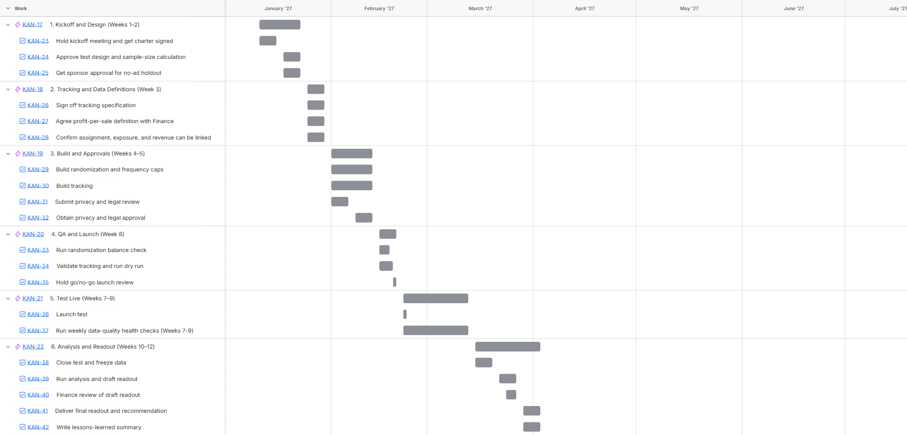
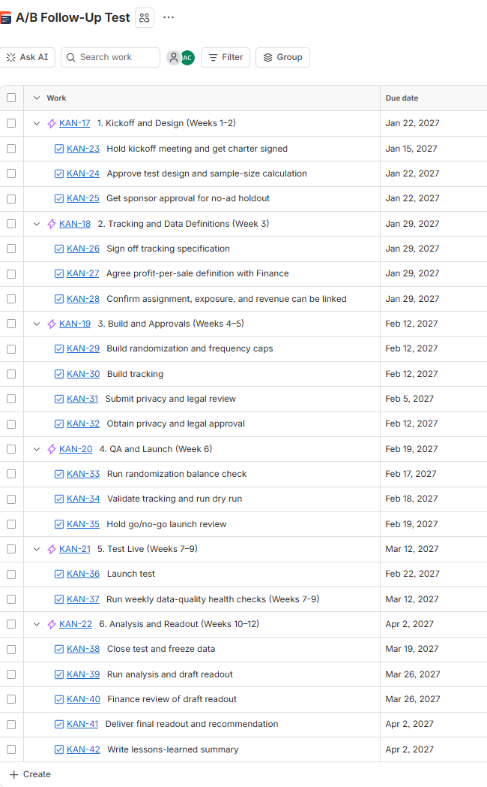
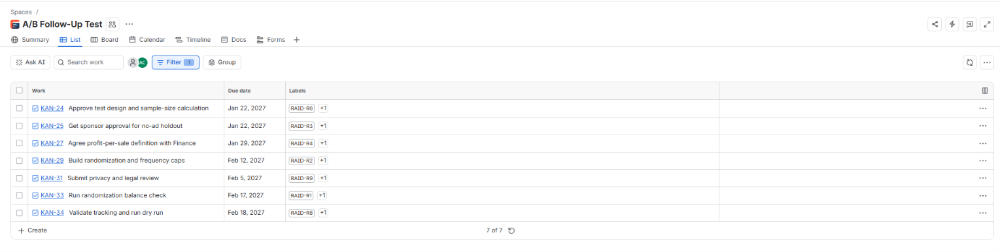

# A/B Follow-Up Test: Project Plan

*Alejandro Acebedo Ciro · November 19, 2026*

A 12-week plan to run a balanced, randomized follow-up to my Ad vs. PSA analysis for a direct-to-consumer digital storefront. It is a planning exercise: the team and costs are hypothetical, and the findings come from my analysis of 588,101 users.

## 1. Project Charter

**Background.** The original analysis found the ad converted at 2.55% vs. 1.79% for the PSA (+0.77 pts, 95% CI 0.60–0.94), about 7.7 extra sales per 1,000 users. Four gaps limit how far that result can be trusted: a 96/4 split, a PSA control instead of no ad, no revenue or cost data, and an exposure effect that may reflect engagement rather than causation.

**Objectives**

1. Measure the incremental lift of the ad vs. no ad using a balanced 50/50 randomized split.
2. Test directly whether ad frequency changes conversion by randomizing frequency caps at assignment.
3. Measure profit per user, not just conversion, using real revenue and cost data.

**Success criteria**

- Randomization passes pre-launch balance checks, and the test goes live at the start of Week 7.
- For the ad vs. no-ad comparison, each arm is sized to detect a 0.39-pt lift (about half the original) at 80% power and 5% significance, assuming a baseline near the PSA’s 1.79%: roughly 21,000 users per arm, confirmed in Week 2. Frequency-cap arms are sized in Week 2.
- The final readout is delivered in Week 12 with the lift, a 95% confidence interval, and profit per user.
- The go/no-go recommendation compares measured profit against the break-even thresholds from the original analysis.
- Privacy and legal approval is secured before launch.

**Scope**

- In scope: test design and sample-size calculation, randomization and frequency caps, tracking requirements, revenue and cost data, analysis, readout.
- Out of scope: ad creative production, changes to targeting or bidding, retention beyond the test window, new channels.

**Deliverables**

1. Signed project charter
2. Test design and sample-size calculation
3. Tracking specification and profit definition
4. Pre-launch QA checklist and go/no-go review
5. Weekly status updates
6. Final readout and recommendation
7. Lessons-learned summary

**Assumptions and constraints**

- Assignment, exposure, and revenue can be linked at the user level.
- The sponsor approves a no-ad holdout.
- 12-week limit; no changes to live campaign targeting; major promotional peaks are avoided.

## 2. Stakeholders and Communication Plan

| Stakeholder | Role in the project | What they need | Influence |
| --- | --- | --- | --- |
| Executive sponsor (Director, E-commerce) | Approves scope, holdout, and go/no-go | A clear decision, the cost of the test, the timeline | High |
| Marketing lead | Owns the campaign and ad delivery | Minimal disruption to live campaigns | High |
| Data and analytics lead | Owns test design and analysis | Clean assignment and exposure data | High |
| Engineering lead | Builds randomization and tracking | A clear spec and stable scope | Medium |
| Finance partner | Defines profit per sale; supplies cost and revenue | An agreed profit definition | Medium |
| Legal and privacy | Approves data collection and use | An early, complete review package | High (gate) |
| Project manager (me) | Plans, tracks, coordinates, reports | Timely input from every owner | Coordinator |

| Communication | Audience | Frequency | Format | Owner |
| --- | --- | --- | --- | --- |
| Kickoff | All stakeholders | Once, Week 1 | 45-minute meeting and charter sign-off | PM |
| Weekly status | Sponsor and leads | Weekly | One-page email: progress, next steps, top 3 risks | PM |
| Team sync | Core team | Weekly, 30 minutes | Meeting; updates the task board | PM |
| Sponsor check-in | Sponsor | Every 2 weeks, 20 minutes | Decisions and escalations | PM |
| Launch go/no-go review | Sponsor, leads, legal | Once, end of Week 6 | Checklist review | PM |
| Mid-test health check | Analytics, engineering | Weekly, Weeks 7–9 | Data-quality summary | Analytics |
| Final readout | All stakeholders | Once, Week 12 | Presentation and written recommendation | PM, Analytics |
| Escalation | Sponsor | As needed | Any issue unresolved after 2 business days goes to the sponsor | PM |

## 3. Work-Back Schedule

Planned backward from the Week 12 readout. The critical path is tracking spec, then instrumentation, then QA, then launch.

| Week | Milestone | Owner | Depends on |
| --- | --- | --- | --- |
| 1 | Kickoff; charter signed | PM | None |
| 2 | Test design and sample-size calculation approved | Analytics | Charter |
| 3 | Tracking spec and profit definition signed off | Analytics, Finance | Test design |
| 4–5 | Randomization and tracking built | Engineering | Tracking spec |
| 4–5 | Privacy and legal review submitted (Week 4) and approved (Week 5) | PM, Legal | Test design, tracking spec |
| 6 | Pre-launch QA (balance check, tracking validation, dry run) and go/no-go review | PM, Analytics | Build, approvals |
| 7–9 | Test live; weekly health checks | Marketing, Analytics | Go decision |
| 10 | Test closes; data frozen and validated | Analytics | Test complete |
| 11 | Analysis and draft readout; Finance review | Analytics, Finance | Frozen data |
| 12 | Final readout, recommendation, lessons learned | PM | Draft readout |

The same schedule built as a Jira timeline, with one epic per phase and the milestones nested underneath:

## 4. RAID Log

| ID | Type | Description | Likelihood | Impact | Owner | Response |
| --- | --- | --- | --- | --- | --- | --- |
| R1 | Risk | Randomization is unbalanced or compromised, as with the original 96/4 split | Medium | High | Analytics | 50/50 allocation within the test population; balance checks before launch; sponsor signs off the assignment logic |
| R2 | Risk | Frequency effect reflects user engagement, not the ad | High | High | Analytics | Assign frequency caps randomly up front instead of reading exposure afterward |
| R3 | Risk | The no-ad holdout costs sales or is rejected | Medium | Medium | PM | Limit the test population to what the power calculation requires, so only that share of traffic goes without the ad; get sponsor approval in Week 2 |
| R4 | Risk | No revenue or cost data at launch | Medium | High | Finance | Profit definition signed off in Week 3; no launch without it |
| R5 | Risk | Seasonality or novelty effects distort results (original data had no timestamps) | Medium | Medium | Analytics | Log timestamps; run full weeks; avoid promotional peaks; compare early and late weeks |
| R6 | Risk | Test is underpowered | Medium | High | Analytics | Sample-size calculation in Week 2; pre-agreed rule to extend the run |
| R7 | Risk | Peeking or multiple comparisons cause false positives | Medium | Medium | Analytics | Fix the primary metric and hypotheses in the charter; no early stopping except for harm |
| R8 | Risk | Tracking bugs or data loss | Medium | High | Engineering | QA and dry run in Week 6; daily checks in the first week live |
| R9 | Risk | Privacy or legal review runs late | Medium | High | PM | Submit in Week 4; flag in weekly status if no response after 5 days |
| A1 | Assumption | Assignment, exposure, and revenue can be linked at the user level | N/A | High | Engineering | Confirm in Week 3; escalate to the sponsor if false |
| A2 | Assumption | Traffic reaches about 21,000 users per arm for the ad vs. no-ad comparison within 3 weeks | N/A | High | Marketing | Check traffic against the sample size in Week 2 |
| D1 | Dependency | Engineering capacity in Weeks 4–5 | N/A | High | Engineering | Book capacity at kickoff |
| D2 | Dependency | Finance delivers cost and revenue definitions by Week 3 | N/A | High | Finance | Request at kickoff; track in weekly status |

Issues: none open at kickoff. A risk that occurs moves to the issue log with an owner and a due date. Sample sizes are approximate planning figures, to be confirmed in Week 2.

## 5. Jira Board

The plan is mirrored in a Jira space. It is a planning exercise with a hypothetical team, so every item stays in its starting status and no one is assigned. Each phase is an epic, each milestone is a work item with an owner and dependency in its description, and each task that answers a RAID item carries a `risk-mitigation` label and a `RAID-R#` label.

### How the Jira board maps to the RAID log

| RAID item | Jira work item | Label |
| --- | --- | --- |
| R1 Randomization is unbalanced | Run randomization balance check | `RAID-R1` |
| R2 Frequency effect reflects engagement | Build randomization and frequency caps | `RAID-R2` |
| R3 Holdout costs sales or is rejected | Get sponsor approval for no-ad holdout | `RAID-R3` |
| R4 No revenue or cost data at launch | Agree profit-per-sale definition with Finance | `RAID-R4` |
| R6 Test is underpowered | Approve test design and sample-size calculation | `RAID-R6` |
| R8 Tracking bugs or data loss | Validate tracking and run dry run | `RAID-R8` |
| R9 Privacy or legal review runs late | Submit privacy and legal review | `RAID-R9` |

Filtering the board by the `risk-mitigation` label shows every planned response to a RAID item in one view:

Each item shows its RAID ID label; the "+1" is the shared `risk-mitigation` label.
